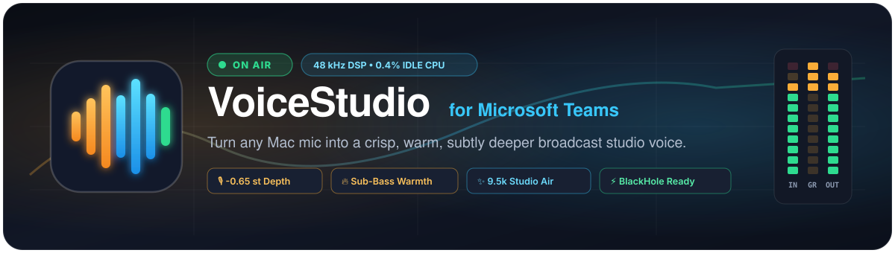
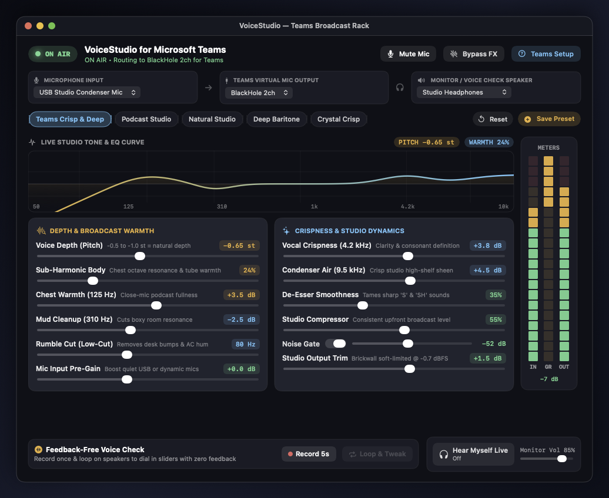
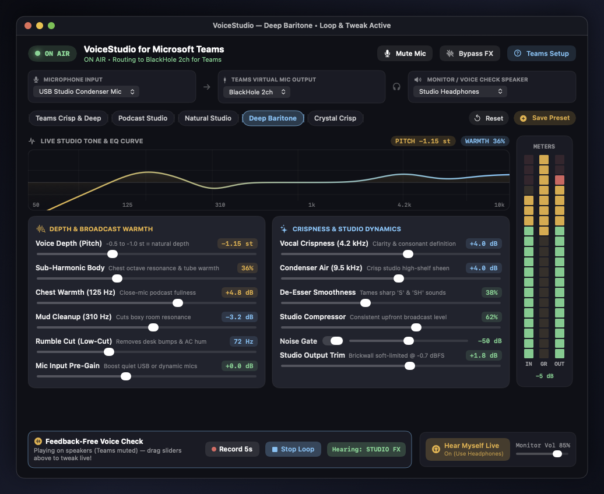
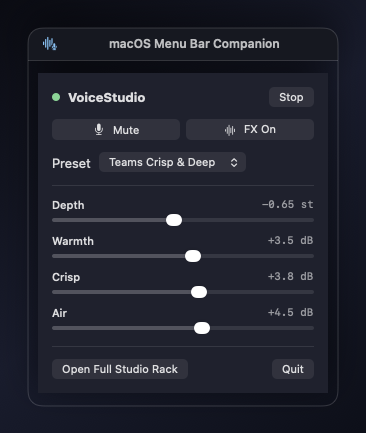

<div align="center">



<br />

[](https://github.com/saadmsft/VoiceStudio/releases/latest/download/VoiceStudio-1.0.0-macOS.dmg)
[](https://github.com/saadmsft/VoiceStudio/releases/latest)
[](Package.swift)
[](https://github.com/saadmsft/VoiceStudio)
[](LICENSE)

<p align="center">
  <b>🎙️ Studio Condenser Sheen</b> • <b>🔥 Subtle Broadcast Depth</b> • <b>⚡ Zero Speaker Hijacking</b> • <b>🎧 Feedback-Free 5s Loop Tweak</b>
</p>

[**⬇️ Download `.dmg`**](#-install-in-30-seconds) · [**📸 Screenshots**](#-studio-console--menu-bar-tour) · [**🎚️ Signal Rack**](#-ascii-broadcast-signal-architecture) · [**💼 Teams Setup**](#-connect-to-microsoft-teams-10-seconds) · [**🎛️ Presets & Knobs**](#️-built-in-voice-presets)

</div>

---

## ✨ Why VoiceStudio?

Laptop and USB microphones often sound **thin, boxy, or harsh** over Microsoft Teams. **VoiceStudio** is a native macOS broadcast rack built in pure Swift (`CoreAudio AUHAL` + `AVAudioEngine` vDSP) that gives your voice **radio-ready authority, warmth, and crisp articulation** in real time—routing cleanly into **`BlackHole 2ch`** while keeping your normal headphones or speakers untouched.

```text
   RAW MIC 🎤                     VOICESTUDIO RACK 🎛️                    TEAMS CALL 💼
 ╭──────────────╮     ╭─────────────────────────────────────────╮     ╭──────────────────╮
 │ Thin / Boxy  │ ──▶ │  -0.65st Depth • Sub-Octave Chest Body  │ ──▶ │ Crisp, Warm,     │
 │ Room Rumble  │     │  4.2k Crispness • 9.5k Air • De-Esser   │     │ Podcast-Grade    │
 │ Uneven Vol   │     │  Noise Gate • Broadcast Leveler (-0.7dB)│     │ Studio Presence! │
 ╰──────────────╯     ╰─────────────────────────────────────────╯     ╰──────────────────╯
```

---

## 📸 Studio Console & Menu Bar Tour

### 🎛️ Main Broadcast Rack (`Teams Crisp & Deep`)
Real-time tone & EQ response visualizer, dual studio processing bays (**Depth & Broadcast Warmth** + **Crispness & Studio Dynamics**), 60 Hz LED Input / Gain-Reduction / Output meters, and one-click value badge resets.

<p align="center">
  
</p>

### 🔁 Feedback-Free `Loop & Tweak` + 🧭 Menu Bar Quick Controller
Record a 5-second phrase once, loop it on your open speakers (while automatically muting Teams), and drag sliders live—or tweak Depth, Warmth, Crisp, and Air mid-meeting right from your macOS Menu Bar!

<table>
  <tr>
    <td width="68%" valign="top">
      
      <p align="center"><sub><b>🔥 Deep Baritone Preset</b> with live speaker <b>Loop & Tweak</b> + <b>STUDIO FX / RAW MIC</b> A/B toggle</sub></p>
    </td>
    <td width="32%" valign="top">
      
      <p align="center"><sub><b>🧭 Menu Bar Companion</b> for instant mid-call tweaks</sub></p>
    </td>
  </tr>
</table>

---

## 🚀 Install in 30 Seconds

### ⚡ Option A — One-Line Magic Installer *(Fastest)*
Checks/installs `BlackHole 2ch`, downloads the latest Universal `.dmg`, installs `VoiceStudio.app` to `/Applications`, clears Gatekeeper quarantine, and launches it:

```bash
curl -fsSL https://raw.githubusercontent.com/saadmsft/VoiceStudio/main/scripts/install.sh | bash
```

### 💿 Option B — Drag-and-Drop `.dmg` Installer

1. **Install the Virtual Audio Cable** *(one-time prerequisite so Teams sees VoiceStudio as a mic)*:
   ```bash
   brew install --cask blackhole-2ch
   ```
2. **Download & Drag to Applications**:
   👉 **[Download `VoiceStudio-1.0.0-macOS.dmg` (Universal Apple Silicon + Intel)](https://github.com/saadmsft/VoiceStudio/releases/latest/download/VoiceStudio-1.0.0-macOS.dmg)**  
   Open the `.dmg` and drag **`VoiceStudio.app`** into **`Applications`**.
3. **First Launch** *(clears macOS browser quarantine on open-source ad-hoc signed builds)*:
   ```bash
   xattr -cr /Applications/VoiceStudio.app && open /Applications/VoiceStudio.app
   ```

> [!NOTE]
> Grant **Microphone** access when macOS prompts you on first launch. VoiceStudio processes 100% of audio locally in RAM with zero network calls or recordings saved to disk.

---

## 💼 Connect to Microsoft Teams (10 Seconds)

```text
┌─────────────────────────────┐      ┌──────────────────────────┐      ┌─────────────────────────────┐
│ 🎤 Physical USB / Built-In  │ ───▶ │ 🎛️ VoiceStudio (ON AIR)  │ ───▶ │ 🔌 BlackHole 2ch (Virtual)  │
└─────────────────────────────┘      └──────────────────────────┘      └──────────────┬──────────────┘
                                                                                      │
                                                                                      ▼
                                                                       ┌─────────────────────────────┐
                                                                       │ 💬 Microsoft Teams Mic      │
                                                                       │ 🔊 Speaker: Normal Spk/HP   │
                                                                       └─────────────────────────────┘
```

1. Launch **VoiceStudio** — it automatically picks your physical mic as **Input** and **`BlackHole 2ch`** as **Teams Virtual Mic Output** (`🟢 ON AIR`).
2. Open **Microsoft Teams → Settings ⚙️ → Devices**:
   - **Microphone**: Select **`BlackHole 2ch`**
   - **Speaker**: Keep your normal **Headphones** or **MacBook Pro Speakers** *(never `BlackHole 2ch`!)*

> [!TIP]
> **Preserve Studio Warmth & 10 kHz Air in Teams:** Set Microsoft Teams **Noise suppression** to **`Low`** or **`Off`**. VoiceStudio already runs a dedicated studio Noise Gate + High-Pass Rumble Cut, and lowering Teams' aggressive filter lets your full 125 Hz chest warmth and 9.5 kHz condenser sheen come through!

---

## 🎚️ ASCII Broadcast Signal Architecture

```text
╔══════════════════════════════════════════════════════════════════════════════════════════════╗
║                        VOICESTUDIO 48 kHz REAL-TIME DSP ENGINE                               ║
╠══════════════════════════════════════════════════════════════════════════════════════════════╣
║                                                                                              ║
║  [🎤 Input AUHAL] ──▶ [🔒 Lock-Free SPSC Ring] ──▶ [🔥 Sub-Harmonic Octave + Tube Drive]     ║
║     (256 frames)          (Drift-Bounded)               (55–112 Hz Chest Body)               ║
║                                                                   │                          ║
║  ┌────────────────────────────────────────────────────────────────┘                          ║
║  ▼                                                                                           ║
║  [🐍 Split-Band De-Esser] ──▶ [🎵 Spectral-Coherent Pitch] ──▶ [📐 6-Band Parametric EQ]      ║
║     (6.6 kHz Sibilance)         (-2.50 to +1.50 Semitones)       • 80 Hz  Rumble HPF         ║
║                                                                  • 125 Hz ChestProximity     ║
║                                                                  • 310 Hz Anti-Mud Cut       ║
║                                                                  • 950 Hz Nasal Smooth       ║
║                                                                  • 4.2kHz Vocal Crispness    ║
║                                                                  • 9.5kHz Condenser Air      ║
║                                                                           │                  ║
║  ┌────────────────────────────────────────────────────────────────────────┘                  ║
║  ▼                                                                                           ║
║  [🚪 Smooth Noise Gate + 🗜️ Broadcast Compressor] ──▶ [🛡️ -0.7 dBFS Soft-Clip Brickwall]     ║
║     (Auto Makeup Gain & Leveling)                                │            │              ║
║                                                                  ▼            ▼              ║
║                                                       [🔌 BlackHole 2ch]  [🎧 Live Monitor]  ║
║                                                        (To Teams Call)     (Optional Spk/HP) ║
╚══════════════════════════════════════════════════════════════════════════════════════════════╝
```

### 📈 Signature Studio EQ Profile (`Teams Crisp & Deep`)

```text
  +6 dB ┤                 ╭───╮                                       ╭────────── ✨ 9.5k Air
  +3 dB ┤              ╭──╯   ╰──╮                           ╭───────╯
   0 dB ┼──────╭───────╯         ╰───╮               ╭───────╯        💎 4.2k Crisp
  -3 dB ┤     ╭╯  🔥 125Hz Chest      ╰─────╮   ╭─────╯
  -6 dB ┤    ╭╯                            ╰───╯ 🧹 310Hz Mud Cut
 -12 dB ┤───╯ 🛡️ 80Hz Rumble Cut
        └──────┬──────────┬──────────┬──────────┬──────────┬──────────┬─────────
             50 Hz     125 Hz     310 Hz      1 kHz     4.2 kHz    10 kHz
```

---

## 🎛️ Built-In Voice Presets

| Preset | Pitch Depth | Sub Body | Tone Signature | Best For |
| :--- | :---: | :---: | :--- | :--- |
| 🌟 **Teams Crisp & Deep** *(Default)* | `-0.65 st` | `24%` | Crisp condenser air + natural warm depth | Daily Microsoft Teams calls & presentations |
| 🎙️ **Podcast Studio** | `-0.50 st` | `32%` | Rich Shure SM7B close-mic FM broadcast tone | Town halls, webinars & recorded demos |
| 🍃 **Natural Studio** | `0.00 st` | `14%` | Zero pitch shift — pure EQ clarity & leveling | Sounding 100% like yourself in a treated studio |
| 🦁 **Deep Baritone** | `-1.15 st` | `36%` | Commanding chest resonance & deep authority | Late-night radio / executive keynote vibe |
| 💎 **Crystal Crisp** | `-0.30 st` | `10%` | High articulation & maximum consonant cut | Noisy environments or muffled headset mics |

> [!IMPORTANT]
> **Zero-Feedback Tuning Trick:** Don't have headphones handy? Click **`🔴 Record 5s`**, read a quick sentence, and hit **`🔁 Loop & Tweak`**. VoiceStudio mutes Teams output and loops your voice on your speakers so you can dial every slider and flip **`Hearing: STUDIO FX`** ↔ **`Hearing: RAW MIC`** with zero feedback!

---

## 🛠️ Controls Reference

<details>
<summary><b>🔍 Click to expand all 12 real-time studio controls</b></summary>

<br />

| Bay | Control | Range | Default | Effect |
| :--- | :--- | :---: | :---: | :--- |
| **🔥 Depth & Warmth** | **Voice Depth (Pitch)** | `-2.50` … `+1.50 st` | `-0.65 st` | Formant-friendly spectral-coherent pitch shift (`-0.5` to `-1.0 st` = sweet spot). |
| | **Sub-Harmonic Body** | `0%` … `100%` | `24%` | Synthesizes clean octave-down vocal chest fundamental + warm asymmetric tube saturation. |
| | **Chest Warmth (125 Hz)** | `-3` … `+9 dB` | `+3.5 dB` | Adds close-mic broadcast fullness. |
| | **Mud Cleanup (310 Hz)** | `0` … `-6 dB` | `-2.5 dB` | Removes boxy desk/room resonance so deeper voices never sound muffled. |
| | **Rumble Cut (Low-Cut)** | `40` … `140 Hz` | `80 Hz` | 12 dB/oct high-pass filter cutting mic stand bumps, plosives, and AC hum. |
| | **Mic Input Pre-Gain** | `-12` … `+18 dB` | `0.0 dB` | Clean digital pre-amp boost for quiet dynamic or USB mics. |
| **✨ Crispness & Dynamics** | **Vocal Crispness (4.2 kHz)** | `-3` … `+9 dB` | `+3.8 dB` | Boosts speech intelligibility & consonant definition across Teams audio codecs. |
| | **Condenser Air (9.5 kHz)** | `-3` … `+10 dB` | `+4.5 dB` | Silky high-shelf studio condenser sparkle. |
| | **De-Esser Smoothness** | `0%` … `100%` | `35%` | Split-band 6.6 kHz dynamic suppressor that tames sharp `"S"` & `"SH"` sibilance. |
| | **Studio Compressor** | `0%` … `100%` | `55%` | Broadcast dynamics leveling with automatic makeup gain. |
| | **Noise Gate** | `-75` … `-25 dB` | `On (-52 dB)` | Silences room noise, keyboard clicks, and fan hum when you pause speaking. |
| | **Studio Output Trim** | `-10` … `+10 dB` | `+1.5 dB` | Final trim into a `-0.7 dBFS` brickwall soft-clip limiter (impossible to clip!). |

*💡 Pro Tip: Click any colored value badge (e.g. `-0.65 st` or `+3.8 dB`) to reset that parameter to its studio default.*

</details>

---

## 🧑‍💻 Build & Package from Source

Requires **macOS 13+** and **Xcode / Swift 5.10+ Command Line Tools**.

```bash
git clone https://github.com/saadmsft/VoiceStudio.git
cd VoiceStudio

# 🧪 Run unit & offline DSP verification suite
swift test

# ⚡ Build & install Release app locally to ~/Applications/VoiceStudio.app
./scripts/bundle-app.sh

# 💿 Build Universal (arm64 + x86_64) distributable DMG in ./dist/
./scripts/build-dmg.sh 1.0.0
```

---

<div align="center">

**Built with ❤️ in native Swift & CoreAudio for crisp calls everywhere.**  
MIT License © [Saad Mahmood](https://github.com/saadmsft)

</div>


