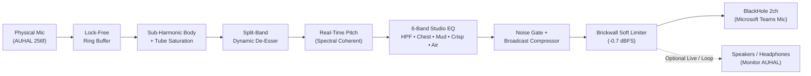

# VoiceStudio for Microsoft Teams

[](https://github.com/saadmsft/VoiceStudio/releases/latest)
[-1f2633)](https://github.com/saadmsft/VoiceStudio/releases/latest)
[](LICENSE)

**VoiceStudio** is an ultra-lightweight (~0.4% idle CPU) native macOS broadcast voice processor built in Swift (`CoreAudio AUHAL` + `AVAudioEngine` vDSP). It transforms standard USB or built-in microphones into a **crisp, studio-grade, subtly deeper broadcast voice** and routes it directly into **`BlackHole 2ch`** for **Microsoft Teams**, Zoom, Slack, or Discord—**without changing your macOS default speaker output**.

---

## Installation

### Option 1 — DMG Installer (Recommended)

1. **Install Virtual Audio Driver (One-Time Prerequisite)**  
   VoiceStudio sends processed audio into `BlackHole 2ch` so Microsoft Teams sees it as a virtual microphone:
   ```bash
   brew install --cask blackhole-2ch
   ```
   *(Or download the pkg installer from [existential.audio/blackhole](https://existential.audio/blackhole/).)*

2. **Download & Mount the DMG**  
   Download **[`VoiceStudio-1.0.0-macOS.dmg`](https://github.com/saadmsft/VoiceStudio/releases/latest/download/VoiceStudio-1.0.0-macOS.dmg)** from [GitHub Releases](https://github.com/saadmsft/VoiceStudio/releases/latest), open it, and drag **`VoiceStudio.app`** into **`Applications`**.

3. **Clear Gatekeeper Quarantine & Launch**  
   Because this open-source build is ad-hoc signed rather than Apple-notarized, clear the browser download quarantine flag once before first launch:
   ```bash
   xattr -cr /Applications/VoiceStudio.app
   open /Applications/VoiceStudio.app
   ```
   Grant **Microphone** permission when macOS prompts you.

---

### Option 2 — One-Line Terminal Installer

Automatically checks/installs `BlackHole 2ch`, downloads the latest `.dmg` from GitHub Releases, installs `VoiceStudio.app` into `/Applications`, clears Gatekeeper quarantine, and launches the app:

```bash
curl -fsSL https://raw.githubusercontent.com/saadmsft/VoiceStudio/main/scripts/install.sh | bash
```

---

## Connect to Microsoft Teams (10 Seconds)

1. Open **VoiceStudio**:
   - **Microphone Input** automatically selects your external physical USB mic (e.g., `fifine Microphone`) or `MacBook Pro Microphone`—never a virtual loopback device.
   - **Teams Virtual Mic Output** automatically selects **`BlackHole 2ch`** and lights up **`ON AIR`**.
2. Open **Microsoft Teams → Settings → Devices**:
   - **Microphone**: Select **`BlackHole 2ch`**.
   - **Speaker**: Keep your normal **Headphones** or **MacBook Pro Speakers** *(never set Speaker to `BlackHole 2ch`)*.
   - **Pro Tip**: Set Teams **Noise suppression** to **Low** or **Off** so Teams' aggressive voice filter doesn't strip away your warm 125 Hz chest resonance or 9.5 kHz condenser air.

---

## Real-Time Broadcast Signal Chain



### Studio Controls Guide

| Module | Parameter | Default (`Teams Crisp & Deep`) | What It Does |
| :--- | :--- | :---: | :--- |
| **Depth & Warmth** | **Voice Depth (Pitch)** | `-0.65 st` | Subtle pitch shift (`-2.50` to `+1.50` semitones) with transient & spectral coherence lock. `-0.50` to `-0.90 st` adds natural vocal authority without sounding artificial. |
| | **Sub-Harmonic Body** | `24%` | Zero-latency fundamental zero-crossing octave tracker (`55–112 Hz`) + warm asymmetric tube harmonics for Shure SM7B-style chest weight. |
| | **Chest Warmth (125 Hz)** | `+3.5 dB` | Low-mid proximity fullness. |
| | **Mud Cleanup (310 Hz)** | `-2.5 dB` | Cuts boxy room resonance so deeper voices remain crystal clear. |
| | **Rumble Cut (Low-Cut)** | `80 Hz` | High-pass filter removing desk thumps, plosives, and AC hum. |
| | **Mic Input Pre-Gain** | `0.0 dB` | Pre-gain trim (`-12` to `+18 dB`) for quiet dynamic or USB mics. |
| **Crispness & Dynamics** | **Vocal Crispness (4.2 kHz)** | `+3.8 dB` | Presence boost so consonants and speech articulation cut cleanly through Teams codecs. |
| | **Condenser Air (9.5 kHz)** | `+4.5 dB` | High-shelf studio condenser shimmer. |
| | **De-Esser Smoothness** | `35%` | Dynamic 6.6 kHz split-band sibilance suppressor that tames harsh `"S"` and `"SH"` sounds. |
| | **Studio Compressor** | `55%` | Broadcast leveling with auto makeup gain so your volume stays consistent whether leaning in or back. |
| | **Noise Gate** | `On (-52 dB)` | Smooth expander that silences keyboard/fan background noise between sentences. |
| | **Studio Output Trim** | `+1.5 dB` | Final output trim feeding a `-0.7 dBFS` soft-clip brickwall limiter (zero digital clipping). |

> **Tip:** Click any colored value pill (e.g. `-0.65 st` or `+3.8 dB`) to snap that individual slider back to its default.

---

## Key Features

- **Feedback-Free 5s Voice Check (`Record 5s` → `Loop & Tweak`)**: Speak naturally for a few seconds, then loop your recording on open laptop speakers while dragging sliders live and toggling **`Hearing: STUDIO FX`** vs **`Hearing: RAW MIC`**—with zero microphone feedback and Teams automatically muted during test playback.
- **Live Headphone Monitor (`Hear Myself Live`)**: Zero-hassle real-time headphone monitoring with independent monitor volume.
- **Built-in + Custom Presets**: Includes *Teams Crisp & Deep*, *Podcast Studio*, *Natural Studio* (0 pitch shift), *Deep Baritone*, and *Crystal Crisp*, plus **Save Preset** persistence.
- **macOS Menu Bar Companion**: Tweak Depth, Warmth, Crispness, Air, Mute, or Presets mid-call right from the macOS menu bar without leaving Teams.

---

## Build DMG or App from Source

Requires macOS 13+ and Xcode / Swift 5.10+ Command Line Tools.

```bash
git clone https://github.com/saadmsft/VoiceStudio.git
cd VoiceStudio

# Run unit & offline DSP tests
swift test

# Build & install locally to ~/Applications/VoiceStudio.app
./scripts/bundle-app.sh

# Build distributable Universal DMG in ./dist/VoiceStudio-1.0.0-macOS.dmg
./scripts/build-dmg.sh 1.0.0
```

## License

MIT © Saad Mahmood

